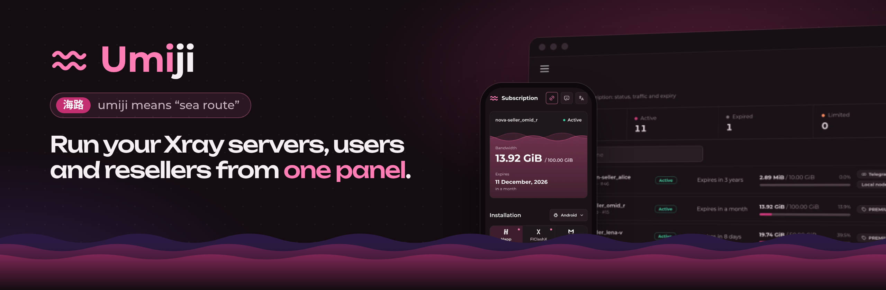

<div align="center">
  

  <p>A proxy management panel built on Xray-core, made for running a VPN business with resellers.</p>

  <p><a href="https://umiji.wiki">Wiki</a> · <a href="https://t.me/umijidev">Telegram channel</a></p>
</div>

## What it does

- **Users, nodes and hosts**: one panel manages every Xray node, user and subscription.
- **Brokers**: reseller accounts that sign in to the same panel but only see their own users, inside a traffic quota,
  a users limit and an expiry date that you set.
- **Telegram store bots**: each broker can connect a bot that sells plans, takes card-to-card or crypto payments with
  receipt review, and delivers subscription links.
- **Branded subscription pages**: every broker gets its own page. Edits show up right away, with no restarts.
- **English and Persian** throughout the panel, the broker panel and the bots.

## Repositories

| Repository | What it is |
| --- | --- |
| [umiji-backend](https://github.com/therewasluna/umiji-backend) | API, workers and scheduler. Also holds the deploy kit and the guides. |
| [umiji-frontend](https://github.com/therewasluna/umiji-frontend) | The web panel. |
| [umiji-subscription-page](https://github.com/therewasluna/umiji-subscription-page) | The page users open from their subscription link. |
| [umiji-node](https://github.com/therewasluna/umiji-node) | Runs Xray-core on each server. |
| umiji (this one) | Overview, logo, help articles and templates the panel loads, and the wiki in `docs/` ([umiji.wiki](https://umiji.wiki), in English and Persian). |

## Get started

On a fresh server, as root:

```bash
bash <(curl -fsSL https://raw.githubusercontent.com/therewasluna/umiji/main/install.sh)
```

The installer ([`install.sh`](install.sh)) asks what the server should run (panel, sub page or node), offers a ready
answer for every question it can, and sets everything up in Docker, one line per step. All three parts can share one
server: a node installed next to the panel is added to the panel's Nodes for you. The
[setup guide](https://umiji.wiki/guide/) walks through it, and
[DEPLOY.md](https://github.com/therewasluna/umiji-backend/blob/main/DEPLOY.md) does the same install by hand.

It also adds the `umiji` command. Type `umiji` on the server later for a menu: install more parts, update, switch the
store bots between polling and webhook, change the owner's password, back up or restore the panel's database, and
uninstall.

### Coming from another panel

```sh
bash <(curl -fsSL https://raw.githubusercontent.com/therewasluna/umiji/main/install.sh) migrate
```

On a server with Umiji's panel, this moves your users from Marzban, PasarGuard, Marzneshin, 3x-ui, Remnawave or
Hiddify, through the old panel's API. They keep their keys, traffic, limits and expiry dates, and their apps keep updating from the old
subscription links. The old panel isn't changed. After that, `umiji migrate` does the same. See
[Move from another panel](https://umiji.wiki/migrate/).

## A fork of Remnawave

Umiji is a fork of [Remnawave](https://github.com/remnawave/panel), the open-source proxy panel by the Remnawave team.
Most of what Umiji can do started there. Umiji adds brokers, their Telegram store bots, live subscription page
updates and the Persian translation, and goes its own way from here. Thank you to everyone who built Remnawave.

## License

AGPL-3.0, see [LICENCE](LICENCE). Like Remnawave, every part of Umiji is free software: if you run a modified version
for others, you have to share its source.
